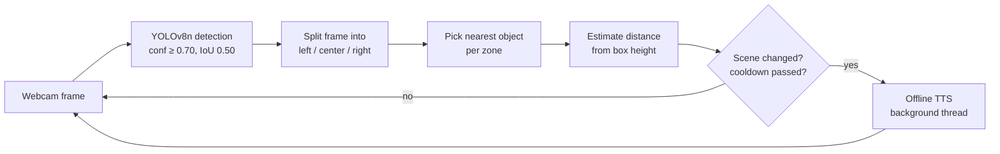
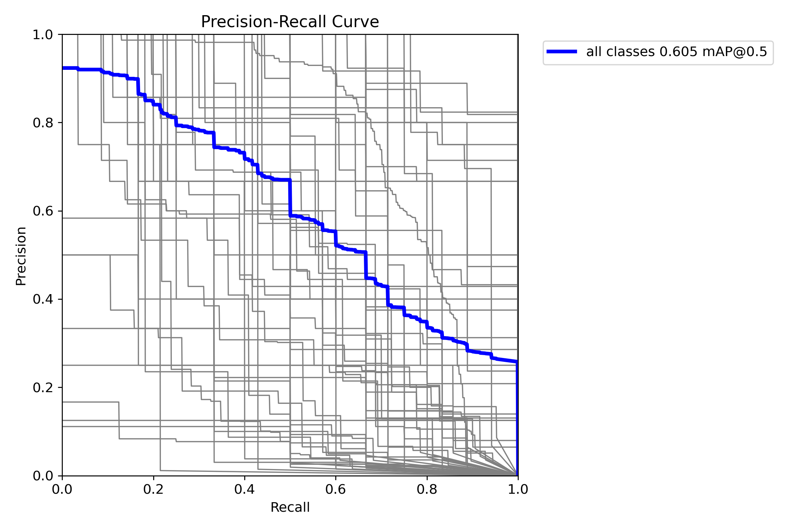
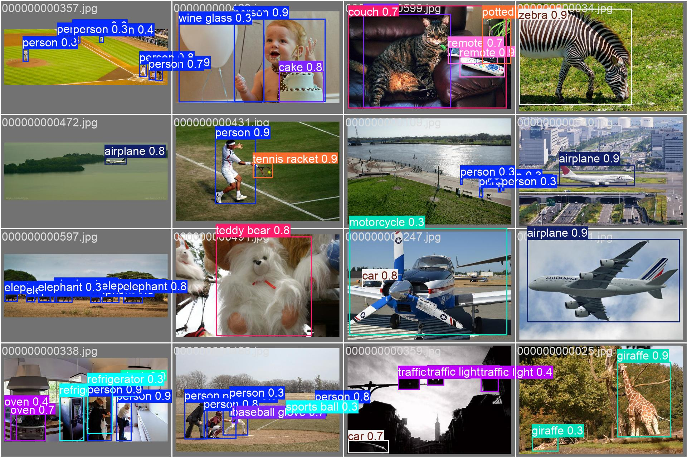
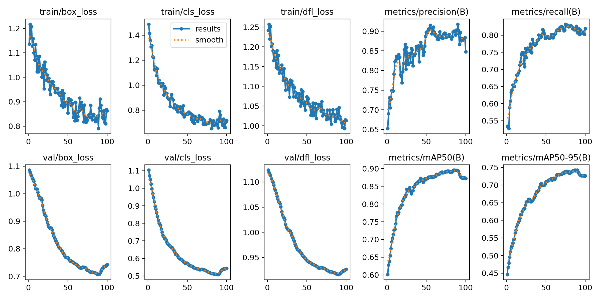

# EchoVision

**Real-time spoken scene descriptions from a webcam, running fully offline.**

EchoVision watches a live camera feed with YOLOv8n, works out where each object sits (left, ahead, right) and roughly how close it is, then says it out loud: *"person very close ahead; chair medium distance on the left"*. It only speaks when the scene changes, so it stays useful instead of noisy. The project is a prototype for assistive "conversational glasses" aimed at people with low vision.


-2ea44f)


---

## Contents

- [How it works](#how-it-works)
- [Features](#features)
- [Quick start](#quick-start)
- [Configuration](#configuration)
- [Build a Windows .exe](#build-a-windows-exe)
- [Model evaluation](#model-evaluation)
- [Performance](#performance)
- [Project structure](#project-structure)
- [Troubleshooting](#troubleshooting)
- [Roadmap](#roadmap)
- [Author](#author)

---

## How it works



1. **Detect.** Each frame goes through YOLOv8n (80 COCO classes) at 640 px. Detections under 0.70 confidence are dropped.
2. **Locate.** The frame is split into three vertical zones. An object's horizontal center decides whether it is *on the left*, *ahead*, or *on the right*.
3. **Prioritise.** Within each zone only the nearest object (largest bounding box) is kept, so the user hears at most three short phrases.
4. **Estimate distance.** The box height as a fraction of frame height maps to a distance label:

   | Box height / frame height | Spoken as |
   |---|---|
   | ≥ 60% | extremely close |
   | ≥ 40% | very close |
   | ≥ 25% | close |
   | ≥ 12% | medium distance |
   | < 12% | far away |

5. **Announce.** `SceneChangeAnnouncer` speaks a new description only after a 3 s cooldown, and repeats an unchanged scene every 15 s as a reminder. A new obstacle *close* or nearer straight ahead skips the cooldown (with a 1 s minimum gap) and cuts off whatever is being said. The object ahead is always spoken first. Speech runs on its own thread and only the latest message is kept, so the video loop never blocks and stale descriptions are never read out.

## Features

- Real-time object detection with YOLOv8n (weights download automatically on first run)
- Spatial cues: left / ahead / right, plus a five-level distance estimate
- Offline text-to-speech with `pyttsx3`; no internet or API keys needed at runtime
- Change-based announcements with cooldown and periodic refresh
- Urgent warnings for close obstacles ahead interrupt current speech (Windows)
- ~25 FPS on a laptop CPU, no GPU needed (see [Performance](#performance))
- Debug overlay showing bounding boxes, confidence scores, zone dividers and the current spoken text
- Works with a webcam index, a video file, or an IP/RTSP stream
- Ships as a single Windows `.exe` via PyInstaller

## Quick start

**Requirements:** Python 3.10 or 3.11, a webcam, and speakers or headphones. Developed and tested on Windows; Linux and macOS should work but are untested.

```powershell
git clone https://github.com/AnKIT7-ops/Echovisionnn.git
cd Echovisionnn

python -m venv .venv
.\.venv\Scripts\Activate.ps1          # Linux/macOS: source .venv/bin/activate
pip install --upgrade pip
pip install -r requirements.txt

python -m src.main
```

A preview window opens and announcements start. Press **Q** in the window (or `Ctrl+C` in the terminal) to quit.

> The first launch downloads `yolov8n.pt` (about 6 MB) from Ultralytics, so it takes a little longer.

## Configuration

Camera and display settings live in [`config.py`](config.py):

| Setting | Default | Purpose |
|---|---|---|
| `CAMERA_SOURCE` | `0` | Webcam index, video file path, or stream URL |
| `CAMERA_FRAME_WIDTH` / `HEIGHT` | `1280` × `720` | Capture resolution |
| `DISPLAY_SCALE` | `1.0` | Resize the preview window |
| `MODEL_PATH` | `yolov8n.pt` | Path to YOLO weights |

Detection and speech tuning is in the source:

| Where | Setting | Default |
|---|---|---|
| `src/main.py` | `CONF_THRESHOLD` | `0.70` |
| `src/main.py` | `IOU_THRESHOLD` | `0.50` |
| `src/main.py` | `IMG_SIZE` | `640` |
| `src/main.py` | `TTSEngine(rate=...)` | `170` words/min |
| `src/main.py` | `SceneChangeAnnouncer(cooldown_seconds, refresh_seconds, urgent_gap_seconds)` | `3.0`, `15.0`, `1.0` |
| `src/tts.py` | `voice_index` | system default voice |
| `src/scene_change.py` | `distance_label()` thresholds | see table above |

## Build a Windows .exe

Run the app once first so `yolov8n.pt` exists in the repo root, then use the included script:

```powershell
.\build.ps1          # add -Clean to wipe old build/ and dist/ folders first
```

The script installs PyInstaller if needed and writes `dist\ConversationalGlasses.exe`, with the model weights and `config.py` bundled inside. Paths are resolved through `sys._MEIPASS`, so the exe runs from any folder. Expect a slow first start while it unpacks.

<details>
<summary>Manual PyInstaller command</summary>

```powershell
pyinstaller --noconfirm --onefile --name ConversationalGlasses `
  --add-data "yolov8n.pt;." `
  --add-data "config.py;." `
  --hidden-import ultralytics `
  --hidden-import torch --hidden-import torchvision --hidden-import torchaudio `
  --collect-all ultralytics --collect-all numpy --collect-all cv2 `
  src/main.py
```

</details>

## Model evaluation

The pretrained YOLOv8n weights were validated on the COCO128 sample set (`datasets/coco128`). Results are saved in [`runs/detect/val`](runs/detect/val).

| Metric | Value |
|---|---|
| mAP@0.5 (all classes) | **0.605** |

<p align="center">
  
  
</p>

Confusion matrices and F1 / precision / recall curves are in the same folder.

## Training

`train.py` fine-tunes the pretrained YOLOv8n on COCO128 (100 epochs, 640 px, batch 16, seed 0). On an RTX 4050 Laptop GPU the run takes about 5.5 minutes (~3.3 s per epoch). Everything it produces is in [`runs/detect/train`](runs/detect/train): per-epoch metrics (`results.csv`), hyperparameters (`args.yaml`), training batches, curves and the weights (`weights/best.pt`).

```bash
pip install torch torchvision --index-url https://download.pytorch.org/whl/cu128   # CUDA build
python train.py
```

| Epoch | box loss | cls loss | mAP@0.5 | mAP@0.5:0.95 |
|---|---|---|---|---|
| 1 | 1.136 | 1.488 | 0.602 | 0.446 |
| 25 | 0.984 | 0.902 | 0.841 | 0.652 |
| 50 | 0.854 | 0.768 | 0.870 | 0.709 |
| 90 (best) | — | — | **0.894** | **0.743** |
| 100 | 0.864 | 0.719 | 0.872 | 0.726 |

<p align="center">
  
</p>

COCO128 uses the same 128 images for training and validation, so these numbers show the model fitting that set, not better accuracy on new images. This run exercises the training pipeline. The app keeps using the pretrained `yolov8n.pt`. Fine-tuning on a separate, held-out obstacle dataset is the next step toward a real accuracy gain.

## Performance

Measured on a Windows 11 laptop, **CPU only** (Intel, 16 threads, no GPU), PyTorch 2.11 CPU build, YOLOv8n at 640 px, webcam capturing 1280×720.

**Live run** (the full app with preview window and speech, 30 s on the laptop webcam):

| Metric | Value |
|---|---|
| FPS | **25.5** |
| Frame time (mean / median / max) | **39.2 / 37.5 / 91.5 ms** |

**Per-stage latency** (benchmark of the same pipeline without display and speech, 200 frames after a 10-frame warm-up):

| Stage | Mean | p95 |
|---|---|---|
| Frame capture | 1.7 ms | 3.8 ms |
| YOLOv8n inference (incl. pre/post-processing) | 40.2 ms | 55.3 ms |
| Scene summary + overlay | 0.3 ms | 0.5 ms |
| **Total per frame** | **42.2 ms** (23.7 FPS) | **57.2 ms** |

Inference is about 95% of the frame time, so a GPU or an exported ONNX/OpenVINO model is where further speed would come from.

**Speech latency:**

| Case | Time until speech starts |
|---|---|
| New close obstacle ahead while another sentence is playing | **< 1 ms** after detection (current sentence is cut off) |
| Normal scene change | after the 3 s cooldown, once the current sentence finishes |

From the camera seeing a new obstacle to the warning starting is therefore about one frame (~40 ms), not counting the camera's own sensor delay.

## Project structure

```
Echovisionnn/
├── src/                    # Main application
│   ├── main.py             # Camera loop, detection, overlay, entry point
│   ├── scene_change.py     # Zone assignment, distance labels, announce logic
│   ├── test_scene_change.py # Self-check for announce timing (python src/test_scene_change.py)
│   └── tts.py              # Threaded latest-message-only TTS with urgent interrupt
├── vision/                 # Early prototype modules
│   ├── detector.py         # Basic YOLO wrapper
│   └── ocr.py              # Tesseract OCR (not wired in yet)
├── speech/                 # Early prototype modules
│   ├── tts.py              # Blocking pyttsx3 helper
│   └── stt.py              # Speech-to-text via SpeechRecognition
├── main.py                 # First prototype (left/center/right only, no distance)
├── config.py               # Camera, model and display settings
├── build.ps1               # PyInstaller build script
├── datasets/coco128/       # Validation sample set
├── runs/detect/val/        # Validation plots and predictions
└── requirements.txt
```

`src/` is the current app. The root `main.py` with `vision/` and `speech/` is the earlier prototype, kept for the OCR and speech-input pieces that are still on the roadmap.

## Troubleshooting

| Problem | Fix |
|---|---|
| `Error: Cannot access camera.` | Set `CAMERA_SOURCE` in `config.py` to `1` or `2`, and close other apps using the webcam |
| No speech | Check the system output device; on Linux install `espeak` (`sudo apt install espeak`) for `pyttsx3` |
| `pyaudio` fails to install on Windows | It is only needed by the prototype's speech input. Run `pip install pipwin && pipwin install pyaudio`, or remove it from `requirements.txt` |
| CUDA / GPU errors | Ultralytics falls back to CPU automatically; YOLOv8n runs fine on CPU |
| Too many or too few announcements | Adjust `CONF_THRESHOLD`, or the cooldown and refresh times in `src/main.py` |

## Roadmap

- [ ] Read signs and labels aloud with OCR (`vision/ocr.py`)
- [ ] Voice commands such as "what's in front of me?" (`speech/stt.py`)
- [ ] Depth model or stereo camera for real distance in metres
- [ ] Fine-tune on navigation classes COCO lacks (poles, stairs, doors, potholes)
- [ ] Run on a Raspberry Pi or phone mounted on glasses

## Author

**Ankit Lakra**
[GitHub](https://github.com/AnKIT7-ops) · [LinkedIn](https://linkedin.com/in/ankit-lakra) · ankitlakarhara@gmail.com
